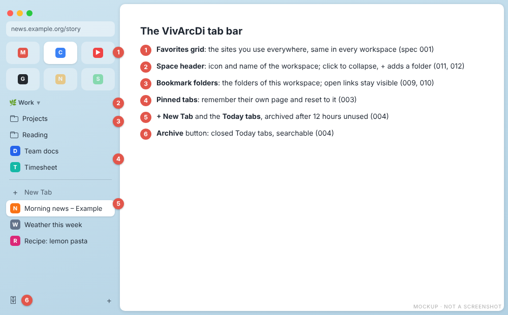
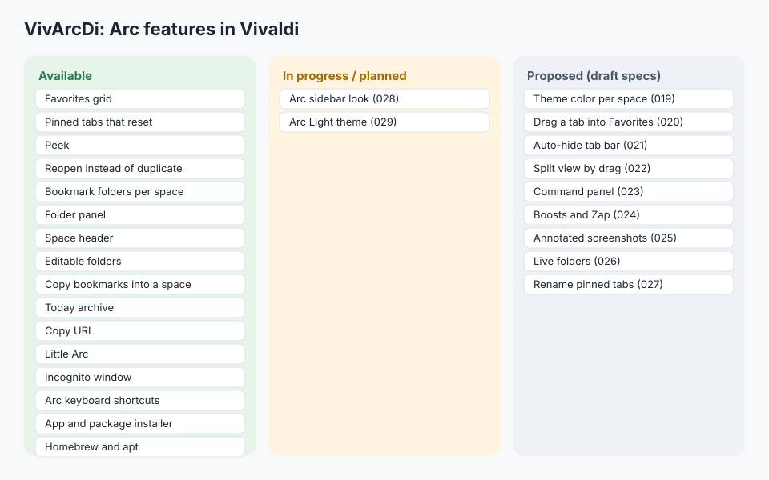
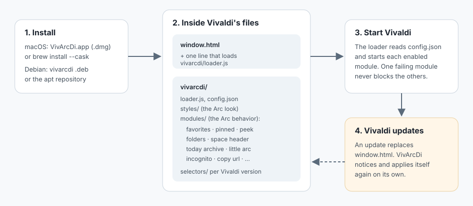

# VivArcDi manual

VivArcDi makes [Vivaldi](https://vivaldi.com) behave like the late [Arc](https://arc.net) browser. It
does not only restyle Vivaldi: it reproduces how Arc works, with a grid of Favorites, pinned tabs that
remember their page, folders in the tab bar, Peek for links, a daily archive of old tabs and Little
Arc for quick lookups.

This manual is for people who use VivArcDi. It describes what each feature does and how to use it.
The [README](../../README.md) has every option of `config.json`, and the [specifications](../../specs/README.md)
have the exact behavior.

## Chapters

1. [Getting started](getting-started.md): install, check, update and remove VivArcDi.
2. [The tab bar](tab-bar.md): Favorites, the space header, folders, pinned tabs and the Arc look.
3. [Peek](peek.md): open a link over the page without leaving it.
4. [Today tabs, archive and keyboard](today-and-keyboard.md): the daily cleanup, copy URL and Arc's shortcuts.
5. [Little Arc](little-arc.md): a small window for a quick lookup.
6. [Incognito](incognito.md): the private window.
7. [What comes next](roadmap.md): the Arc features that are designed but not built yet.
8. [Images and GIFs](assets.md): the graphic assets of this manual and the recordings still to make.

## Arc features in VivArcDi

| Arc feature | VivArcDi | Status | Spec |
|---|---|---|---|
| Favorites grid shared by every space | [Favorites](tab-bar.md#favorites) | Available | [001](../../specs/001-favorites-grid/spec.md), [003](../../specs/003-pinned-tabs-and-folders/spec.md) |
| Pinned tabs that reset to their page | [Pinned tabs](tab-bar.md#pinned-tabs) | Available | [003](../../specs/003-pinned-tabs-and-folders/spec.md) |
| Peek | [Peek](peek.md) | Available | [002](../../specs/002-peek/spec.md), [015](../../specs/015-peek-new-tab-links/spec.md) |
| "Switch to Tab" instead of a duplicate | [Reopen pinned tabs](tab-bar.md#no-duplicate-tabs) | Available | [007](../../specs/007-reopen-pinned-tabs/spec.md) |
| Folders in the sidebar, one set per space | [Folders](tab-bar.md#folders) | Available | [009](../../specs/009-bookmark-folders-in-tab-bar/spec.md), [010](../../specs/010-folders-per-workspace/spec.md), [012](../../specs/012-editable-folders/spec.md), [018](../../specs/018-copy-bookmarks-to-workspace/spec.md) |
| Folder preview on hover | [Folder panel](tab-bar.md#folder-panel) | Available | [008](../../specs/008-folder-hover-preview/spec.md) |
| Space name and icon in the sidebar | [Space header](tab-bar.md#space-header) | Available | [011](../../specs/011-space-header/spec.md) |
| Today tabs archived after 12 hours | [Today archive](today-and-keyboard.md#today-archive) | Available | [004](../../specs/004-today-tabs-and-keyboard/spec.md) |
| Copy URL (Cmd+Shift+C) | [Copy URL](today-and-keyboard.md#copy-url) | Available | [004](../../specs/004-today-tabs-and-keyboard/spec.md) |
| Arc keyboard shortcuts | [Shortcuts](today-and-keyboard.md#arc-keyboard-shortcuts) | Available | [014](../../specs/014-arc-shortcuts/spec.md) |
| Little Arc | [Little Arc](little-arc.md) | Available | [005](../../specs/005-little-arc/spec.md) |
| Incognito window | [Incognito](incognito.md) | Available | [013](../../specs/013-incognito-mode/spec.md) |
| One-click install, automatic re-apply | [Getting started](getting-started.md) | Available | [016](../../specs/016-plug-and-play-installer/spec.md), [017](../../specs/017-package-managers/spec.md) |
| Arc's sidebar look | [Arc look](tab-bar.md#the-arc-look) | In progress | [028](../../specs/028-arc-sidebar-look/spec.md) |
| Arc Light theme for all of Vivaldi | [What comes next](roadmap.md#arc-light-theme) | Planned | [029](../../specs/029-arc-light-theme/spec.md) |
| Theme color per space | [What comes next](roadmap.md#theme-color-per-space) | Proposed | [019](../../specs/019-space-theme-color/spec.md) |
| Drag a tab into the Favorites | [What comes next](roadmap.md#drag-a-tab-into-the-favorites) | Proposed | [020](../../specs/020-drag-tab-to-favorites/spec.md) |
| Sidebar that hides and shows at the edge | [What comes next](roadmap.md#auto-hide-tab-bar) | Proposed | [021](../../specs/021-auto-hide-tab-bar/spec.md) |
| Split view by dragging a tab | [What comes next](roadmap.md#split-view-by-drag) | Proposed | [022](../../specs/022-split-from-drag/spec.md) |
| Command Bar with tab actions | [What comes next](roadmap.md#command-panel) | Proposed | [023](../../specs/023-command-panel/spec.md) |
| Boosts and Zap | [What comes next](roadmap.md#boosts-and-zap) | Proposed | [024](../../specs/024-site-boosts-and-zap/spec.md) |
| Annotated screenshots | [What comes next](roadmap.md#annotated-screenshots) | Proposed | [025](../../specs/025-annotated-screenshots/spec.md) |
| Live folders | [What comes next](roadmap.md#live-folders) | Proposed | [026](../../specs/026-live-folders/spec.md) |
| Rename and re-icon pinned tabs | [What comes next](roadmap.md#rename-pinned-tabs) | Proposed | [027](../../specs/027-rename-pinned-tabs/spec.md) |

Status meanings: **Available** ships in a release. **In progress** is approved and partly built.
**Planned** is approved and not started. **Proposed** is a draft spec still open for discussion.

## How it works

VivArcDi is not a Vivaldi extension. Vivaldi draws its own interface with web technologies, and
VivArcDi adds its stylesheets and scripts to that interface. The installer puts them in place and
applies them again after every Vivaldi update.

Everything VivArcDi saves, such as your folders and pinned pages, is an ordinary Vivaldi bookmark or
lives in Vivaldi's own storage. If you remove VivArcDi, your bookmarks stay and your pinned tabs
become ordinary pinned tabs.

The developer view of the same picture is in [architecture.md](../architecture.md).

## About the images

The pictures marked **Mockup** are drawn to explain a feature. They are not screenshots of Vivaldi.
One clip, marked **Arc reference**, was recorded in Arc. Real recordings of VivArcDi will replace the
mockups: see [Images and GIFs](assets.md).
