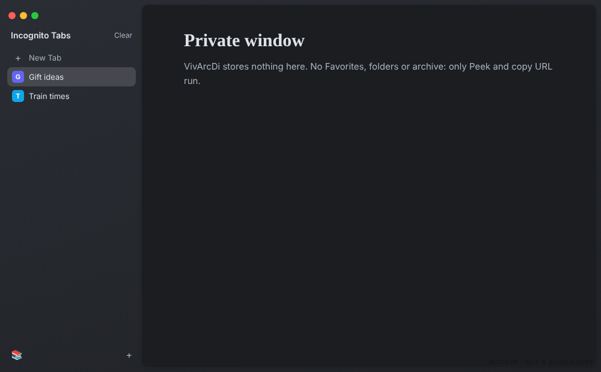

# Incognito

[Back to the manual](README.md)

A private window of Vivaldi gets the bare sidebar of Arc's incognito window.

From top to bottom:

- **Incognito Tabs**, with **Clear** on the right when the pointer rests on it. Clear closes every tab
  of the window except the active one.
- **New Tab**, which opens a blank private tab and puts the cursor in the address field.
- The private tabs.
- A bottom bar with **Library** (Vivaldi's Downloads panel) on the left and `+` on the right.

VivArcDi stores nothing in a private window. Only Peek and Copy URL run there; the Favorites, folders,
pinned tab marks and the Today archive stay off. A normal window open at the same time is not affected.
