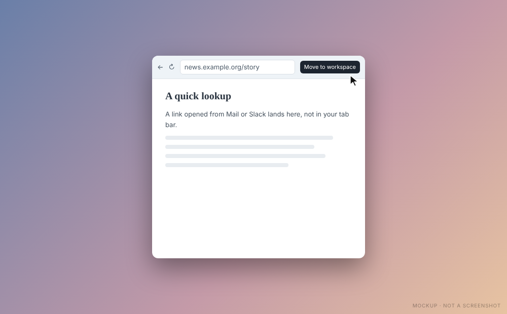
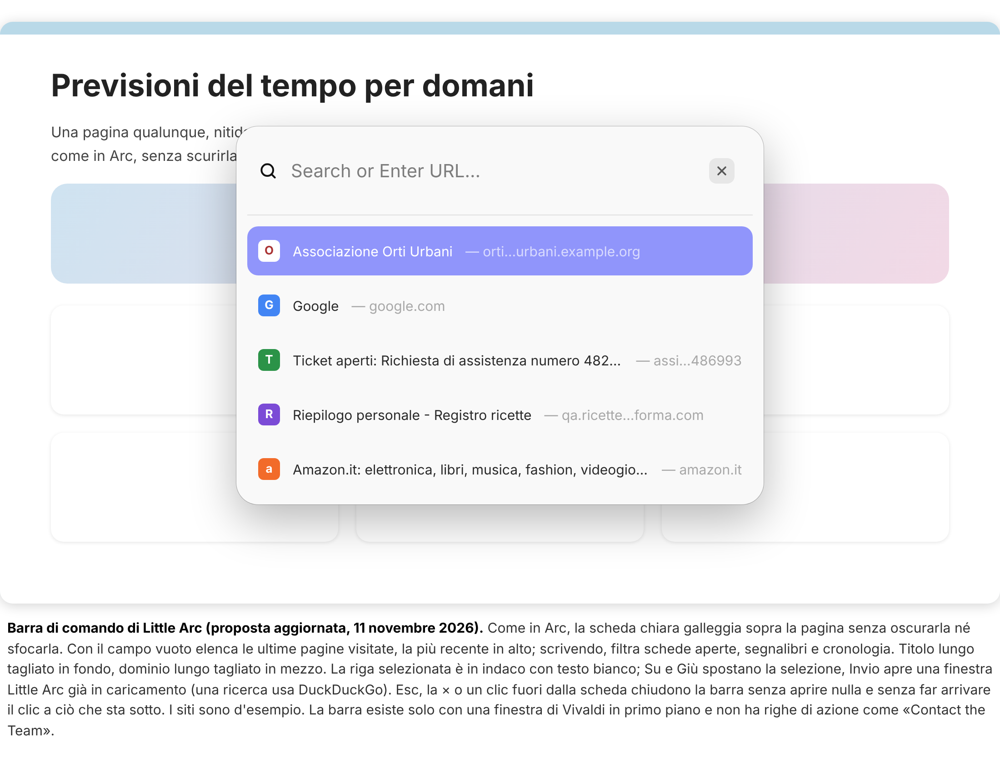

# Little Arc

[Back to the manual](README.md)

Little Arc is a small window for a quick lookup. It has no tab bar, no panels and no workspace
switcher: only back, an address pill and **Open in** a workspace.

## Open it

- **Cmd+Opt+N** (Ctrl+Alt+N on Debian) shows the **command bar**, a light card over your window with
  a search field and a list. The page under it is not dimmed or blurred.

  

  - With the field empty, the list is the pages you visited last, newest first.
  - Type, and the first row is your text ("Search for ..." or "Open site"), followed by the best
    matches among your open tabs, bookmarks and history. The list has at most five rows.
  - Up and Down move the selection (it wraps around), or point at a row with the mouse. Enter or a
    click opens the row in a Little Arc window that is already loading. A text that is not an address
    is searched on DuckDuckGo.
  - Esc, the x button, a click outside the card or the shortcut again close the bar and open nothing.
    The click outside does not reach what is under the card.
  - With `commandBar` set to `false`, or if the bar cannot be shown, the shortcut opens an empty
    Little Arc window with the address field ready.
- A **link opened from another app**, such as Mail, Slack or Notes, opens in Little Arc instead of a
  tab of your main window.

Little Arc works while Vivaldi is open. A key that works from every app is not part of this version.

## Keep it or let it go

- **Open in** a workspace or Cmd/Ctrl+O turns the page into a tab of the workspace you used last and
  closes the small window.
- Esc in an empty address field, or Cmd/Ctrl+W, closes it and forgets the page.
- A Little Arc window nobody touched for six hours closes by itself.

The command bar, the size, the idle time and links from other apps are options of `little-arc`
([README](../../README.md#little-arc)).
