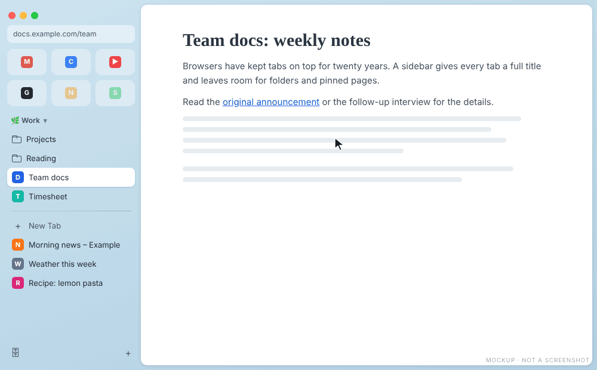
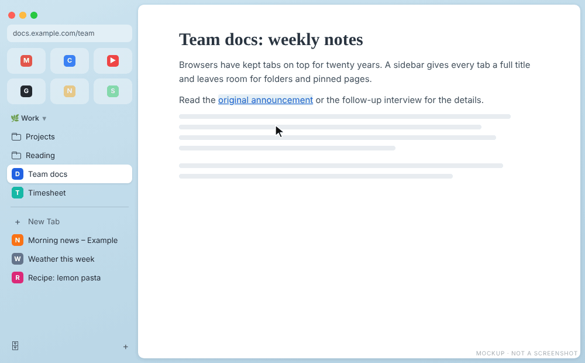

# Peek

[Back to the manual](README.md)

Peek opens a link in a rounded panel over the page you are reading. The page behind stays where it
was, dimmed. The panel holds the real page: you can scroll it, type in it and follow its links.

## When a link opens in Peek

- **Shift+click** on any link.
- In a **Favorite**, a **pinned tab** or a **folder link**: a link to another site, so the tab keeps its
  own page. Subdomains count as the same site.
- In the same tabs: a link that asks for a new tab (`target="_blank"`), even on the same site.

Options in `config.json` extend Peek to every tab; see the [README](../../README.md#peek).

## Inside Peek

The buttons sit outside the panel, on its right:

| Button | Key | Effect |
|---|---|---|
| Close | Esc, Cmd/Ctrl+W, or a click on the dimmed area | Closes Peek, never the tab behind |
| Expand | Cmd/Ctrl+O | Opens the page as a tab next to the current one |
| Split | | Opens the page as a tab tiled side by side with the current one |

Switching tab also closes Peek.

A link from a pinned tab opens in Peek; Split puts both pages side by side:

