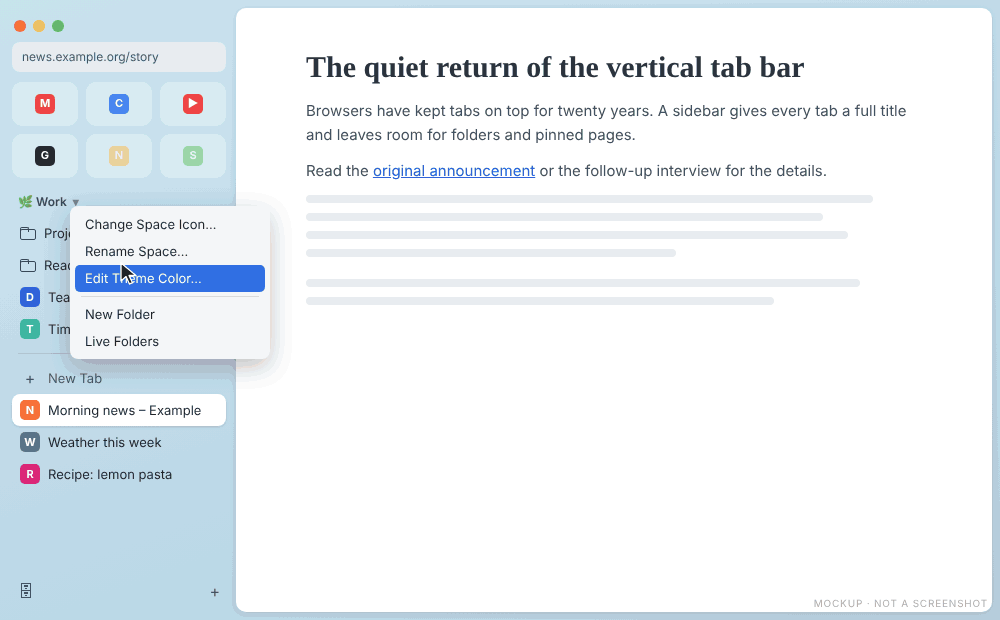
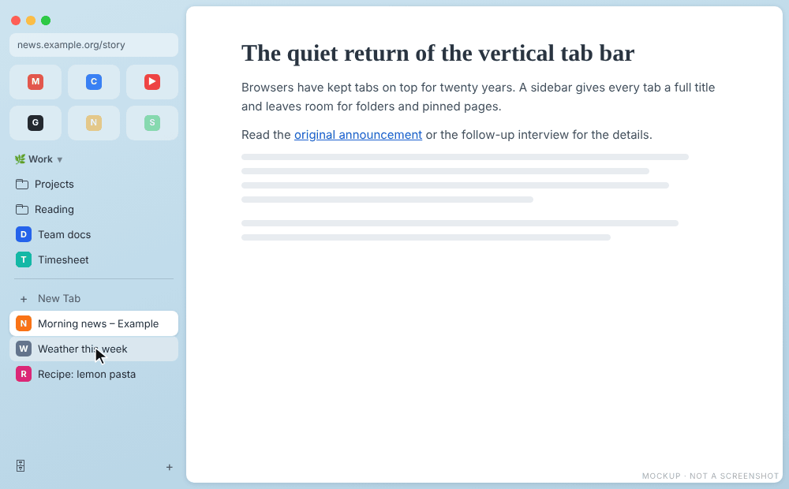
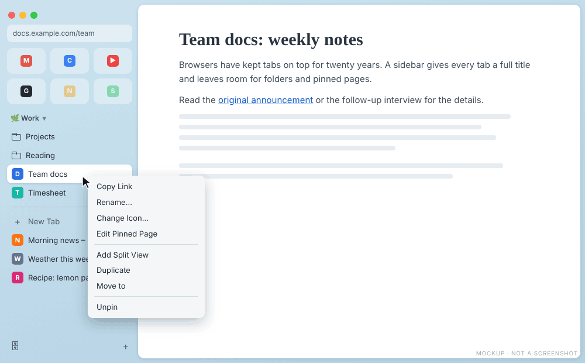

# What comes next

[Back to the manual](README.md)

These Arc features have a specification but are not in VivArcDi yet. **Planned** specs are approved
and wait for their turn. **Proposed** specs are drafts: their behavior can still change, or they can be
dropped. Each section links its spec. The pictures are mockups of how the feature is meant to look.

## Arc Light theme

Planned, [spec 029](../../specs/029-arc-light-theme/spec.md).

One command gives all of Vivaldi a light Arc look, not only the tab bar: a native Vivaldi theme
"VivArcDi Light" for menus, panels and fields, and a soft diagonal gradient behind the tab bar and
around the page, from warm coral to pale aqua. The page sits in a white frame with round corners.
Another command brings your previous theme back.

## Theme color per space

Proposed, [spec 019](../../specs/019-space-theme-color/spec.md).

Each workspace gets its own color, so you see where you are without reading its name. **Edit Theme
Color…** in the menu of the space header opens a picker like Arc's: light, dark or automatic mode, a
color area with a handle that changes the colors live, nine preset swatches, an intensity slider and a
grain dial. Switching workspace switches the color.

## Drag a tab into the Favorites

Proposed, [spec 020](../../specs/020-drag-tab-to-favorites/spec.md).

Drag a tab onto the Favorites grid to make it a Favorite, dropped between two tiles to choose its
place. Drag a tile out of the grid to remove the Favorite and keep the page as a Today tab. Tiles can be
reordered by dragging.

## Auto-hide tab bar

Proposed, [spec 021](../../specs/021-auto-hide-tab-bar/spec.md).

Hide the tab bar with Cmd/Ctrl+S to give the page the whole width. Move the pointer to the left edge
and the bar slides over the page; move away and it hides again. A button or Cmd/Ctrl+S keeps it open.

## Split view by drag

Proposed, [spec 022](../../specs/022-split-from-drag/spec.md).

Drag a tab onto the left or right edge of the page to see both side by side, or onto the top or bottom
edge to stack them. The pair shows as one row in the tab list, and **Pin split** keeps it as one pinned
entry with its own name and icon.

## Command panel

Proposed, [spec 023](../../specs/023-command-panel/spec.md).

A panel like Arc's Command Bar, opened with Cmd/Ctrl+Shift+K. Type an action such as "pin" and run it
on the current tab (Pin, Unpin, Favorite, Pin to folder, Archive, Copy URL, Copy as Markdown link),
switch to an open tab by part of its title, or type a site name and a query to search that site.

## Boosts and Zap

Proposed, [spec 024](../../specs/024-site-boosts-and-zap/spec.md).

**Boost this site** (Cmd/Ctrl+Shift+B) opens a small panel with a font, a background and a text color
for the site. **Zap** turns the pointer into a picker: click an element to hide it on every page of the
site, also after a restart.

## Annotated screenshots

Proposed, [spec 025](../../specs/025-annotated-screenshots/spec.md).

After Vivaldi's own capture, draw on the picture with an arrow, a box, a pen or text, then copy it with
Cmd/Ctrl+C or save it with Cmd/Ctrl+S.

## Live folders

Proposed, [spec 026](../../specs/026-live-folders/spec.md).

A folder that fills itself. The first source lists the open pull requests of a GitHub repository, one
row per pull request with its title and author. It refreshes every five minutes, and closed pull
requests leave the folder.

## Rename pinned tabs

Proposed, [spec 027](../../specs/027-rename-pinned-tabs/spec.md).

Right click a pinned row or a Favorite tile and choose **Rename…** for a short label or **Change
icon…** for an emoji. **Reset** brings back the page title and icon. The name and icon stay with the
bookmark.

The menus of a pinned tab (Rename, Change Icon, Edit Pinned Page) and of the space header (Edit Theme
Color, New Folder, Live Folders), as specs 019, 026 and 027 propose them:

