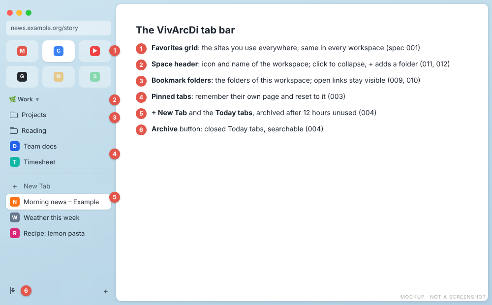
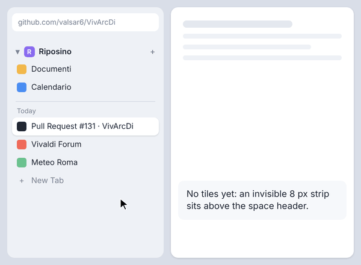
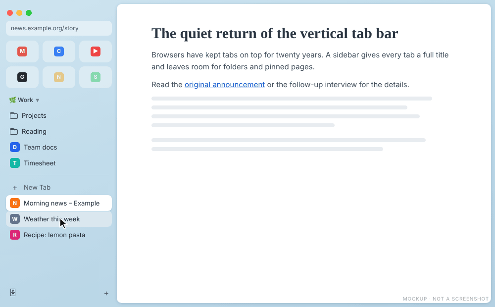
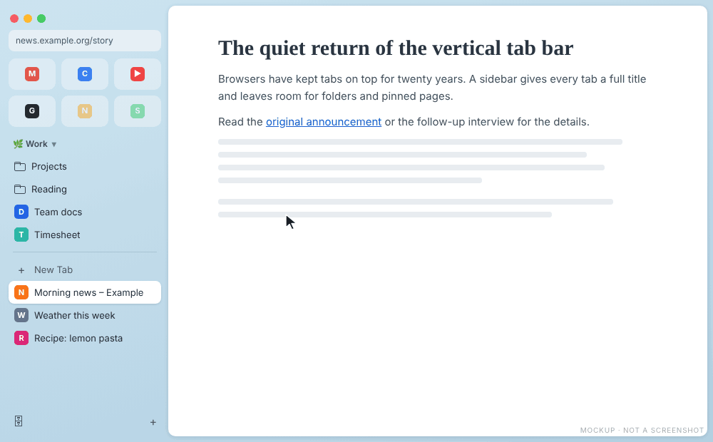
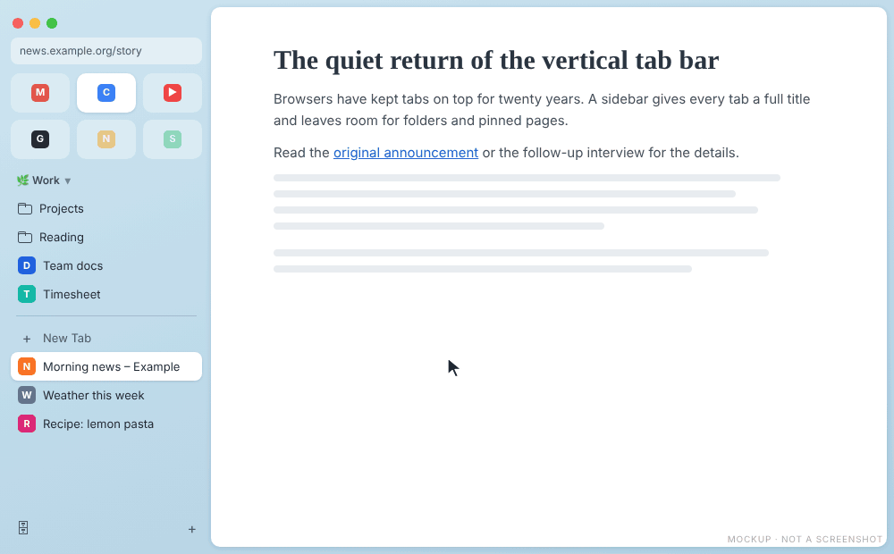

# The tab bar

[Back to the manual](README.md)

In Arc the sidebar is the browser: the sites you always use at the top, then the space you are in,
its folders and pinned pages, and below a line the pages you opened today. VivArcDi builds the same
order inside Vivaldi's vertical tab bar.

1. [Favorites](#favorites)
2. [Space header](#space-header)
3. [Folders](#folders), with the [folder panel](#folder-panel)
4. [Pinned tabs](#pinned-tabs)
5. **+ New Tab** and the Today tabs, see [Today archive](today-and-keyboard.md#today-archive)
6. The archive button

Turn on the vertical tab bar first: Settings > Tabs > Tab Bar Position > **Left**. Each Vivaldi
workspace plays the part of an Arc space.

## Favorites

The Favorites are a grid of square tiles at the top of the tab bar, at most three columns, the same in
every workspace.

- **Choose them.** Make a bookmark folder named `Favorites` and put the sites in it. The order of the
  bookmarks is the order of the tiles. Without that folder, the first pinned tabs of the workspace
  become the tiles.
- **Open one.** Click a tile. The first time it opens as a hidden pinned tab of the workspace; after
  that the click brings you back to it. Each workspace keeps its own tab for each Favorite.
- **Browse away.** A link followed inside a Favorite's tab changes what the tab shows, not the
  bookmark. The tile keeps its favicon, and a click on it activates the tab without resetting it.
- **Unload it.** Middle click, Cmd/Ctrl+W or the close button unload the tab instead of closing it.
  The tile stays, dimmed, and a click loads the bookmark's page again.
- **Add one by dragging.** Take a tab from the list or from the pinned rows and release it over the
  grid. The tiles move apart to leave a gap where it will land, and a new tile appears there with the
  page's icon, the same in every workspace. The tab stays open as the tab of that Favorite. The
  `Favorites` folder is created if it does not exist. A page that is already a Favorite stays as it
  is.
- **Add the first one.** While there are no tiles, drag a tab of today or a link row just above the
  space header. An invisible strip there opens to the height of a tile; release the tab on it and the
  page becomes the first tile. Once a tile exists, the strip is gone and you drop on the grid.

  
- **Reorder by dragging.** Drag a tile and keep it over the grid: its place closes and the tiles
  open a gap where it will land. Release it there and the order stays in every workspace, after a
  restart and on the devices that sync the bookmarks, because it is the order of the `Favorites`
  folder.
- **Take one out by dragging.** Drag a tile out of the grid and release it. Below the separator the
  page becomes a Today tab at that place; on a folder, between folder rows or on the space header it
  becomes a link of the workspace. The tile disappears from every workspace and the page is never
  lost. Released outside the tab bar, nothing changes.
- **See what you drag.** While a tab, a link row or a tile is dragged over the tab bar, a white pill
  with its icon and title follows the pointer and the place it came from fades.
- **Untile or pin from the menu.** Right-click a tile: **Untile tab** puts the page back as the first
  tab of today and removes the tile from every workspace; **Pin tab** makes it a link of the
  workspace's folder.
- **Menu of a tile.** Right-click a tile for the same items as a [link row](#folders), without
  **Move to**: **Copy Link** copies the saved address and shows a toast, **Edit Pinned Page** opens
  **Edit…** to type the address the tile opens first or **Replace Pinned URL with Current** to take the
  address of the open tab, **Open in Split View** shows the page of the tile beside the selected tab,
  and **Duplicate** adds a closed copy right after the tile. A tile is one bookmark, so these changes
  show in every workspace.
- **Open a tile as a web panel.** Right-click a tile and choose **Open as web panel**: the page
  appears in Vivaldi's side panel in its mobile layout, as if you had added it with the **+** of the
  panel bar. A tile whose page is already a panel shows **Show web panel**, which brings it up. To
  remove a panel use Vivaldi's panel bar.

The active tile is a light pill; dimmed tiles are unloaded or not open yet in this workspace.

## Space header

A row between the Favorites and the folders shows the icon and name of the active workspace.

- Click it to collapse the workspace: the folders show only the links that have an open tab, and
  unloaded pinned tabs hide. Click again to open it. Each workspace remembers its state.
- Rest the pointer on it to show `+`, which adds a folder.
- Right click it for a menu with **New Folder**, the same as `+`, and **Live Folders** › **GitHub**,
  which adds a [live folder](live-folders.md) of your pull requests.
- Rename the workspace and change its icon from Vivaldi's workspace menu; the row follows.

## Folders

Each workspace shows its own bookmark folder in the tab bar, as Arc spaces show their folders.
By default it is `VivArcDi/<workspace name>` in your bookmarks, made the first time you add something.
You can point a workspace at any existing folder in `config.json` (see the
[README](../../README.md#bookmark-folders)).

- **Open and close** a folder with a click. Subfolders open inside their parent, and the state
  survives a restart.
- **Open a link** with a click. Its row becomes its tab: a dot marks it as open, and it stays visible
  below its folder when you close the folder, as in Arc. The tab is hidden from Vivaldi's own tab list,
  so the list holds only the pages you opened outside the Favorites, pinned tabs and folders.
- **Close a link** with the `×` on hover or Cmd/Ctrl+W: the link goes back inside its folder.
- **Scroll** the column as one list, as in Arc: the Favorites stay in place at the top, the Archive footer
  at the bottom, and the folders and the Today tabs between them scroll together, however long the
  folders are. The scroll bar is thin and shows only while you scroll.

Every change below is a real bookmark, so it shows in Vivaldi's Bookmarks panel:

| To | Do |
|---|---|
| Add a folder | Rest the pointer on the space header and click `+`, then type the name |
| Rename a folder | Double click it, or right-click it and choose **Rename…** |
| Duplicate a folder | Right-click it and choose **Duplicate**: a closed copy, without tabs, appears right below it |
| Move a folder to another workspace | Right-click it, choose **Move to** and pick the workspace: the folder and its open tabs go there |
| Delete a folder | Right-click it and choose **Delete**: it goes to the Trash of the Bookmarks panel and its open tabs close |
| Move a tab into a folder | Drag the tab onto the folder row, onto the space header, or between two rows |
| Take a link out | Drag its row below the separator to make it a tab of today, or onto the Favorites grid to make it a Favorite |
| Pin a tab of today | Right-click it and choose **Pin tab** in Vivaldi's menu |
| Make a tab of today a tile | Right-click it and choose **Tile tab** |
| Keep a tile's site beside the page | Right-click the tile and choose **Open as web panel** |
| Put a link back among today's tabs | Right-click its row and choose **Remove pin** |
| Make a link a tile | Right-click its row and choose **Tile tab** |
| Rename a link or give it an icon | Right-click its row, then **Rename…** or **Change Icon…** |
| Rename or re-icon a tile | Right-click the tile, then **Rename…** or **Change Icon…** |
| Copy the address of a link | Right-click its row and choose **Copy Link** |
| Change the address a link opens first | Right-click its row, **Edit Pinned Page**, then **Edit…** (or **Replace Pinned URL with Current**) |
| Open a link beside the page you are on | Right-click its row and choose **Open in Split View** |
| Copy a link below itself | Right-click its row and choose **Duplicate** |
| Move a link to another workspace | Right-click its row, **Move to**, then the workspace or **New Space…**; click the toast to follow it |
| Keep the current page | Cmd/Ctrl+D adds it at the end of the workspace's folder; press it again to undo |
| Copy bookmarks in | Drag a bookmark or a whole folder from Vivaldi's Bookmarks panel onto the folders |

A deleted folder is not erased: restore it from the Trash in the Bookmarks panel. Moving folders stays in the Bookmarks panel.

### Folder panel

Rest the pointer on a closed folder: a panel opens next to the tab bar with a search field and every
link of the folder, the most recently opened first, each with the time since you last opened it. Type
to filter, use Up and Down, and press Enter or click to open. Esc closes the panel.

## Pinned tabs

Pinned tabs are rows below the folders. Each workspace has its own.

- A pinned tab remembers the page it was pinned with. Following a link inside it changes what it
  shows, not its own page; the favicon stays the same and there is no back arrow. Closing and
  reopening the tab loads its own page again.
- The **minus** at the right end of the row, Cmd/Ctrl+W and the close affordance unload a pinned tab
  instead of closing it. The row stays, dimmed; a click loads its own page. **Close tab** and
  **Unpin tab** in the menu still close or unpin it.
- The row's menu has **Edit Pinned Page**, with **Replace Pinned URL with Current** and **Edit…**, to
  change the page it opens first.
- In a pinned tab, a link to another site opens in [Peek](peek.md), so the tab keeps its page; a link
  that asks for a new window opens in [Little Arc](little-arc.md).

## Names and icons

Rows and tiles show the title and favicon of the page. Arc lets you shorten the name and pick an icon,
and VivArcDi keeps both with the link, so they survive a restart and show in every workspace.

- **Rename.** Right-click a link row or a tile and choose **Rename…**: the title becomes a field with
  the text selected. Enter saves, Esc cancels, and a click elsewhere saves. Saving an empty name brings
  back the page title. A tile edits the name in a field under its icon, and shows the name when you
  rest the pointer on it for three seconds.
- **Choose an icon.** **Change Icon…** opens a popover beside the row with two tabs. `Emoji` has a
  search field, focused, and a scrolling grid of emoji with the category buttons at the bottom; typing
  filters the grid. `Icons` has the same line symbols as the folder menu. The chosen emoji or symbol
  replaces the favicon, and **Reset** brings back the page title and the favicon together.
- **Refresh the favicon.** **Refresh favicon** in the picker reads the icon of the site again, for a
  site that changed it, and clears the chosen emoji.
- **A tile made from a pinned tab** can be renamed and re-iconed too, even though it has no bookmark.
- **The name follows Vivaldi Sync.** A name set on one computer shows on the others after a sync. The
  icon stays on the computer where you chose it, for now.

The rename never changes the address of the link, and Vivaldi's own Bookmarks panel keeps the original
title.

## No duplicate tabs

When you type in a new tab the address of a Favorite, a pinned tab or a folder link of the workspace,
VivArcDi takes you to that tab instead of opening a second copy, like Arc's "Switch to Tab". The empty
new tab closes.

## The Arc look

The **sidebar look** module gives the tab bar Arc's style: rows without a background at rest, a light
pill for the active tab, Favorites tiles on a light veil, a thin line above `+ New Tab`, a scroll bar
that shows only while scrolling, and the workspace color behind the tab bar. Choose the colors with the
`palette` option. This work is in progress ([spec 028](../../specs/028-arc-sidebar-look/spec.md)), and
the [Arc Light theme](roadmap.md#arc-light-theme) will extend it to the rest of Vivaldi.

