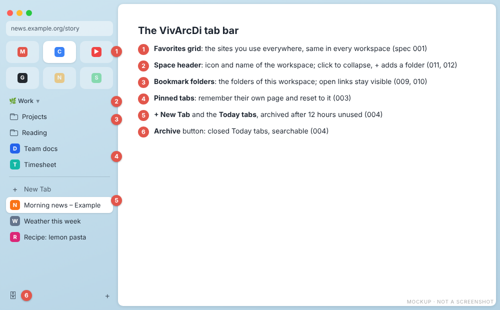
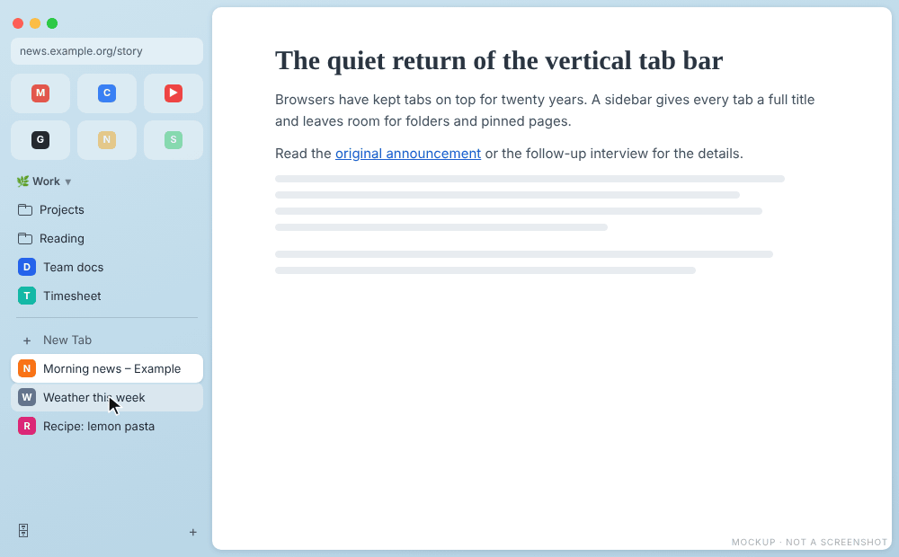
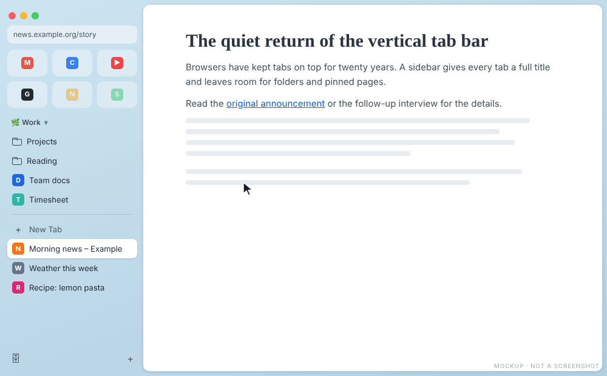
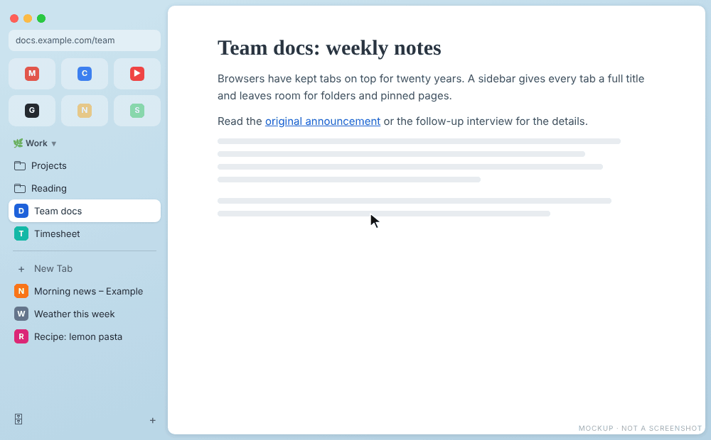
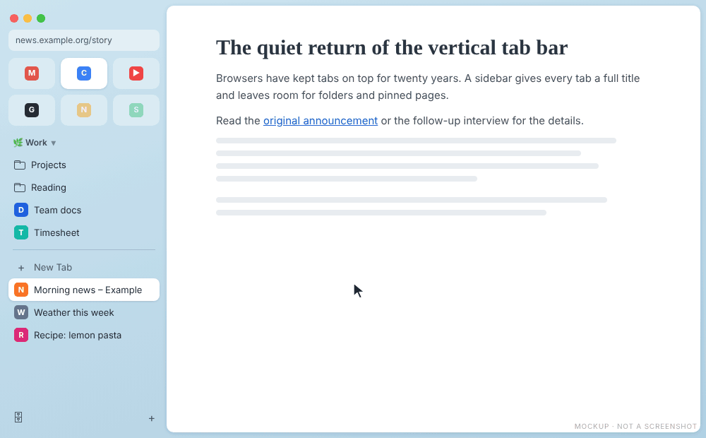

# The tab bar

[Back to the manual](README.md)

In Arc the sidebar is the browser: the sites you always use at the top, then the space you are in,
its folders and pinned pages, and below a line the pages you opened today. VivArcDi builds the same
order inside Vivaldi's vertical tab bar.

1. [Favorites](#favorites)
2. [Space header](#space-header)
3. [Folders](#folders), with the [folder panel](#folder-panel)
4. [Pinned tabs](#pinned-tabs)
5. **+ New Tab** and the Today tabs, see [Today archive](today-and-keyboard.md#today-archive)
6. The archive button

Turn on the vertical tab bar first: Settings > Tabs > Tab Bar Position > **Left**. Each Vivaldi
workspace plays the part of an Arc space.

## Favorites

The Favorites are a grid of square tiles at the top of the tab bar, at most three columns, the same in
every workspace.

- **Choose them.** Make a bookmark folder named `Favorites` and put the sites in it. The order of the
  bookmarks is the order of the tiles. Without that folder, the first pinned tabs of the workspace
  become the tiles.
- **Open one.** Click a tile. The first time it opens as a hidden pinned tab of the workspace; after
  that the click brings you back to it. Each workspace keeps its own tab for each Favorite.
- **Go home.** Click the tile of the current tab after you browsed away: the tab goes back to the
  Favorite's page.
- **Unload it.** Middle click, Cmd/Ctrl+W or the close button unload the tab instead of closing it.
  The tile stays, dimmed, and a click loads it again.
- **Add one by dragging.** Take a tab from the list or from the pinned rows and release it over the
  grid. The tiles move apart to leave a gap where it will land, and a new tile appears there with the
  page's icon, the same in every workspace. The tab stays open as the tab of that Favorite. The
  `Favorites` folder is created if it does not exist. A page that is already a Favorite stays as it
  is.
- **Take one out by dragging.** Drag a tile out of the grid and release it. Below the separator the
  page becomes a Today tab at that place; on a folder, between folder rows or on the space header it
  becomes a link of the workspace. The tile disappears from every workspace and the page is never
  lost. Released over the grid or outside the tab bar, nothing changes.

The active tile is a light pill; dimmed tiles are unloaded or not open yet in this workspace.

## Space header

A row between the Favorites and the folders shows the icon and name of the active workspace.

- Click it to collapse the workspace: the folders show only the links that have an open tab, and
  unloaded pinned tabs hide. Click again to open it. Each workspace remembers its state.
- Rest the pointer on it to show `+`, which adds a folder.
- Rename the workspace and change its icon from Vivaldi's workspace menu; the row follows.

## Folders

Each workspace shows its own bookmark folder in the tab bar, as Arc spaces show their folders.
By default it is `VivArcDi/<workspace name>` in your bookmarks, made the first time you add something.
You can point a workspace at any existing folder in `config.json` (see the
[README](../../README.md#bookmark-folders)).

- **Open and close** a folder with a click. Subfolders open inside their parent, and the state
  survives a restart.
- **Open a link** with a click. Its row becomes its tab: a dot marks it as open, and it stays visible
  below its folder when you close the folder, as in Arc. The tab is hidden from Vivaldi's own tab list,
  so the list holds only the pages you opened outside the Favorites, pinned tabs and folders.
- **Close a link** with the `×` on hover or Cmd/Ctrl+W: the link goes back inside its folder.

Every change below is a real bookmark, so it shows in Vivaldi's Bookmarks panel:

| To | Do |
|---|---|
| Add a folder | Rest the pointer on the space header and click `+`, then type the name |
| Rename a folder | Double click it |
| Move a tab into a folder | Drag the tab onto the folder row, onto the space header, or between two rows |
| Take a link out | Drag its row below the separator to make it a tab of today, or onto the Favorites grid to make it a Favorite |
| Keep the current page | Cmd/Ctrl+D adds it at the end of the workspace's folder; press it again to undo |
| Copy bookmarks in | Drag a bookmark or a whole folder from Vivaldi's Bookmarks panel onto the folders |

Deleting and moving folders stays in the Bookmarks panel.

### Folder panel

Rest the pointer on a closed folder: a panel opens next to the tab bar with a search field and every
link of the folder, the most recently opened first, each with the time since you last opened it. Type
to filter, use Up and Down, and press Enter or click to open. Esc closes the panel.

## Pinned tabs

Pinned tabs are rows below the folders. Each workspace has its own.

- A pinned tab remembers the page it was pinned with. When it shows another page, its icon turns into
  a back arrow: click the arrow to return.
- Cmd/Ctrl+W and the close button unload a pinned tab instead of closing it. **Close tab** in the
  context menu still closes it.
- In a pinned tab, a link to another site opens in [Peek](peek.md), so the tab keeps its page.

## No duplicate tabs

When you type in a new tab the address of a Favorite, a pinned tab or a folder link of the workspace,
VivArcDi takes you to that tab instead of opening a second copy, like Arc's "Switch to Tab". The empty
new tab closes.

## The Arc look

The **sidebar look** module gives the tab bar Arc's style: rows without a background at rest, a light
pill for the active tab, Favorites tiles on a light veil, a thin line above `+ New Tab`, a scroll bar
that shows only while scrolling, and the workspace color behind the tab bar. Choose the colors with the
`palette` option. This work is in progress ([spec 028](../../specs/028-arc-sidebar-look/spec.md)), and
the [Arc Light theme](roadmap.md#arc-light-theme) will extend it to the rest of Vivaldi.

