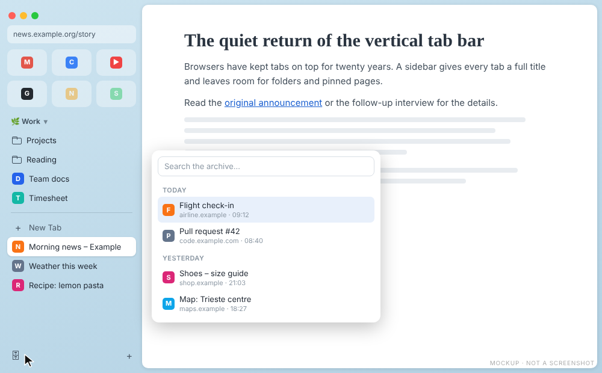
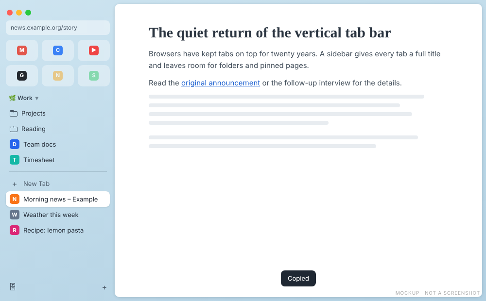

# Today tabs, archive and keyboard

[Back to the manual](README.md)

## Today archive

Arc keeps the tab bar short by closing the tabs you have not looked at for a while. VivArcDi does the
same with the **Today tabs**: every tab that is not a Favorite, not pinned, not a folder link and not in
a stack.

- A Today tab that has not been active for 12 hours is closed and kept in the archive. The hours
  Vivaldi was closed count too.
- The active tab and a tab that plays audio are never archived.
- **Clear**, shown when you rest the pointer on the line under the pinned tabs, archives every Today tab
  of the workspace except the active one.

Open the archive with the button at the bottom of the tab bar or Cmd/Ctrl+Shift+A. It lists the closed
tabs by day, with a search field. Up and Down move, Enter or a click reopens the tab in its workspace,
Esc closes the panel. The archive stays on your computer.

Change the delay with `archiveAfterHours`, or turn the archive off with `enabled: false`
([README](../../README.md#today-archive)).

## Copy URL

Cmd/Ctrl+Shift+C copies the address of the current tab, also while the page has the focus, and shows
"Copied" at the bottom of the window.

## Arc keyboard shortcuts

Tick **Also use Arc's keyboard shortcuts** in the VivArcDi window, or use **Use Arc's shortcuts**
later. **Restore my shortcuts** puts yours back. Close Vivaldi first: it rewrites its settings when it
quits.

| Key (macOS / Debian) | Does |
|---|---|
| Cmd+T / Ctrl+T | Vivaldi's Quick Commands, which also open links in a new tab |
| Cmd+S / Ctrl+S | Shows or hides the tab bar |
| Cmd+D / Ctrl+D | Adds the page to the workspace's folder, or takes it out again |
| Cmd+P / Ctrl+P | Print |
| Cmd+Opt+N / Ctrl+Alt+N | [Little Arc](little-arc.md) |
| Cmd+Shift+C / Ctrl+Shift+C | Copy URL |
| Cmd+Shift+A / Ctrl+Shift+A | Today archive |
| Cmd+W / Ctrl+W | Closes a Today tab; unloads a Favorite or pinned tab; closes Peek |
| Cmd+O / Ctrl+O | Expands Peek or Little Arc into a tab |

The [native settings guide](../native-settings.md) lists the Vivaldi settings that match the rest of
Arc's keys, such as Ctrl+Tab in recent order.
